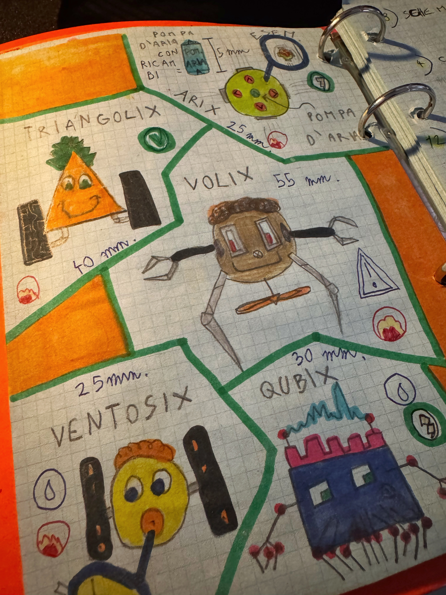

<Beside>

</Beside>

As a kid I wanted to be a mad scientist, and I meant it. I spent my afternoons filling an orange binder with projects: robots of every shape, complicated machines, unlikely inventions. I dreamed of buying an Ape Car, the tiny Italian three-wheeler, and turning it into a mobile lab.

None of those robots ever left the page. I built with LEGO and took apart any device I could get my hands on, to see how it worked inside. Putting it back together, most of the time, I could not.

The binder did one thing right, though: it kept everything. The ideas that worked and the ones left halfway sat in the same place, one after the other.

## The tools are here now

Today the AI writes the code. I design the architecture, prepare the context the agent works in, check and ship. The distance between an idea and something that actually runs has shrunk enormously, so the ideas that used to stay on paper now become projects.

Many are born, and not all of them reach the end. That is fine, as long as I do not lose them.

## The grown-up binder

This site does the binder's job. The [projects](/en/projects) page has all of them, each with its real status: in progress, the tools I use every day, ideas on hold, archived.

And every project carries the attempts that came before it. [Nexus](/en/projects/nexus), where I keep my tasks, notes and data today, came after quite a line of others:

<Attempts project="nexus" title="Where Nexus comes from" />

Its page also tells what each one left to the next.

How I work with agents is in the [method](/en/method). The Ape Car, on the other hand, is still in the binder.
