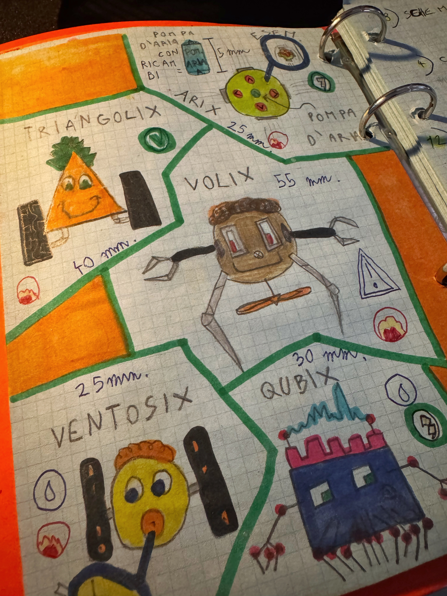

<Beside caption="Misure al millimetro e pezzi di ricambio già previsti. Robot costruiti: zero.">

</Beside>

Da bambino volevo fare lo scienziato pazzo, e lo dicevo sul serio. Passavo i pomeriggi a riempire un raccoglitore arancione di progetti: robot di ogni forma, macchine complicate, invenzioni improbabili. Sognavo di comprare un'Ape Car e trasformarla in un laboratorio mobile.

Nessuno di quei robot è mai uscito dal foglio. Costruivo con i LEGO e smontavo qualunque apparecchio mi capitasse a tiro per capire com'era fatto dentro. Rimontarlo, il più delle volte, non ci riuscivo.

Il raccoglitore però una cosa la faceva bene: teneva tutto. Le idee riuscite e quelle lasciate a metà stavano nello stesso posto, una dopo l'altra.

## Gli attrezzi adesso ci sono

Oggi il codice lo scrive l'AI. Io progetto l'architettura, preparo il contesto in cui l'agente lavora, verifico e rilascio. La distanza tra un'idea e qualcosa che gira davvero si è accorciata tantissimo, e così le idee che prima restavano sul foglio adesso diventano progetti.

Ne nascono tanti, e non tutti arrivano in fondo. Va bene così, a patto di non perderli.

## Il raccoglitore, versione adulta

Oggi a fare da raccoglitore è questo sito. Nella pagina dei [progetti](/it/progetti) ci sono tutti, ciascuno con il suo stato reale: quelli in corso, gli strumenti che uso ogni giorno, le idee ferme, quelli archiviati.

E ogni progetto si porta dietro i tentativi che l'hanno preceduto. [Nexus](/it/progetti/nexus), dove oggi tengo task, note e dati, è arrivato dopo una bella fila di altri:

<Attempts project="nexus" title="Da dove viene Nexus" />

Nella sua scheda c'è anche quello che ognuno ha lasciato al successivo.

Come lavoro con gli agenti l'ho scritto nel [metodo](/it/metodo). L'Ape Car invece è ancora nel raccoglitore.
